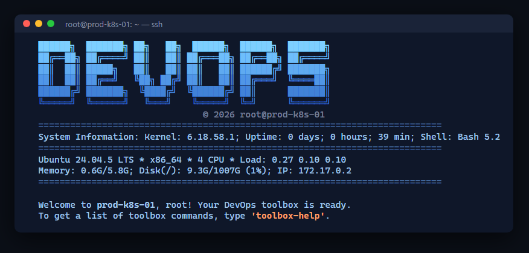
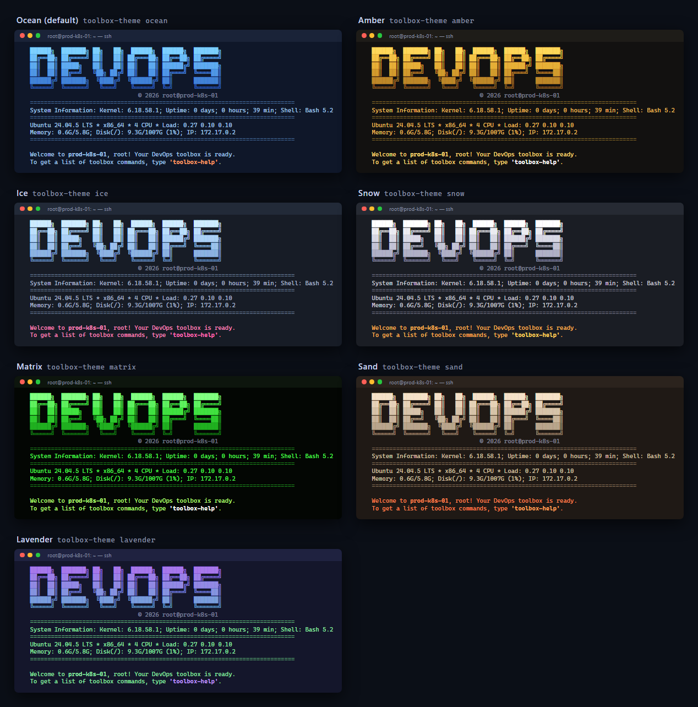

# DevOps Toolbox

Make a fresh Linux server ready for DevOps work with one command. An interactive, colourful menu lets you choose what goes on the box: modern CLI tools, Kubernetes and cloud CLIs, alias packs and dotfiles. Then it shows a custom login banner.

```bash
curl -fsSL https://raw.githubusercontent.com/uthrapathy-m/devops-toolbox/main/install-devops-tool.sh | bash
```

<p align="center"></p>

The installer menu looks like this:

```
  Step 2/3 · CLI Utilities  (1/5 · profile: Core CLI)

  ❯ [✔] fzf                Fuzzy finder (Ctrl-R history, Ctrl-T files)  ● 0.75.0
    [✔] zoxide (z)         Smarter cd that learns your dirs
    [ ] bat                cat with syntax highlighting
    ...
  ↑/↓ move · space toggle · a all/none · enter next · b back · q quit
```

## Login banner

Every new SSH session opens with the banner shown above: the gradient DEVOPS logo plus live system data (kernel, uptime, OS, load, memory, disk, IP and, when installed, Docker and Kubernetes status).

### Themes

There are 7 colour themes, inspired by [bashfolio](https://github.com/rushhiii/bashfolio). **Ocean** is the default.

<p align="center"></p>

| Theme | Logo gradient | Accent |
|---|---|---|
| `ocean` | cyan → deep blue | orange |
| `amber` | gold → bronze | white |
| `ice` | ice-blue → steel | pink |
| `snow` | white → grey | orange / yellow |
| `matrix` | neon green → dark green | white |
| `sand` | beige → tan | orange-red |
| `lavender` | purple → blue | green text, purple accent |

```bash
toolbox-theme              # preview colour swatches for every theme
toolbox-theme matrix       # switch (saved to ~/.devops-toolbox/custom.sh)
bash install-devops-tool.sh --theme amber   # choose at install time
```

Tip: give each environment its own colour (for example, `matrix` on prod and `ocean` on dev) so you can tell at a glance which server you're on.

- `toolbox-help` lists the aliases and tools that are actually installed on this machine.
- `toolbox-banner` shows the banner again.
- `DEVOPS_TOOLBOX_BANNER` controls what appears at login: `1` for this banner (default), `fastfetch` for the detailed fastfetch view, or `0` for nothing. Set it in `~/.devops-toolbox/custom.sh`.

## How it works

1. **Pick a profile**: Minimal, Core CLI, K8s Ops, Cloud, Everything or Custom.
2. **Fine-tune each category.** Every item is a checkbox, pre-ticked from the profile you picked.
3. **Review and install.** You get a live spinner for each tool and a summary at the end, followed by your new login banner.

Anything already installed shows `● version` and is skipped. Pass `--upgrade` to reinstall it at the latest version.

## Catalog

| Category | Items |
|---|---|
| CLI Utilities | fzf, zoxide (`z`), bat, eza, ripgrep, fd, jq, yq, tldr, ncdu, tmux, git-delta, lazygit, starship |
| Monitoring | btop, htop, fastfetch (with a custom login banner) |
| Containers & Kubernetes | docker + compose, kubectl, helm, k9s, kubectx/kubens, stern, lazydocker, dive |
| Cloud & IaC | terraform, opentofu, ansible, AWS CLI v2, Azure CLI, gcloud |
| Aliases & Dotfiles | General, Git, Kubernetes and Docker alias packs, tmux.conf, fzf defaults |

Run `--list` to print every item id.

## Non-interactive use (automation, cloud-init)

```bash
# a whole profile, no questions
curl -fsSL https://raw.githubusercontent.com/uthrapathy-m/devops-toolbox/main/install-devops-tool.sh | bash -s -- -p k8s -y

# exact items
curl -fsSL .../install-devops-tool.sh | bash -s -- -t fzf,btop,zoxide,alias-git -y

# upgrade everything already installed
curl -fsSL .../install-devops-tool.sh | bash -s -- -p everything -y --upgrade
```

| Flag | Meaning |
|---|---|
| `-p, --profile` | `minimal`, `core`, `k8s`, `cloud`, `everything`, `custom` |
| `-t, --tools` | Comma-separated item ids (adds to the profile) |
| `-y, --yes` | Skip all menus |
| `-u, --upgrade` | Reinstall tools that are already present |
| `--no-banner` | Don't show the login banner |
| `--theme` | Banner colours: `ocean`, `amber`, `ice`, `snow`, `matrix`, `sand`, `lavender` |
| `--list` | List item ids and profiles |
| `--uninstall` | Remove the toolbox shell config and the binaries it installed |

## Supported systems

- **Distros:** Ubuntu and Debian (apt); RHEL, Rocky, Alma, CentOS Stream, Fedora and Amazon Linux (dnf/yum).
- **CPU:** x86_64 and arm64 (Graviton, Ampere, Raspberry Pi).
- **Shell:** bash.
- **With sudo or root:** tools go to `/usr/local/bin`, and the system package manager handles tmux, htop, ncdu and docker.
- **Without sudo:** static binaries go to `~/.local/bin`. Tools that only come from the package manager are reported and skipped.

Most tools come from their **latest GitHub release**. If you hit the GitHub API rate limit, run `export GITHUB_TOKEN=...` first.

## What it changes on your machine

| Path | Purpose |
|---|---|
| `~/.bashrc` | One line that sources `~/.devops-toolbox/init.sh` |
| `~/.devops-toolbox/init.sh` | PATH, completions, zoxide, fzf and starship hooks |
| `~/.devops-toolbox/banner.sh` | The login banner and `toolbox-help` |
| `~/.devops-toolbox/aliases.sh` | The alias packs you picked (regenerated on every run) |
| `~/.devops-toolbox/custom.sh` | **Your own** aliases; never overwritten |
| `~/.devops-toolbox/logs/` | One install log per tool |
| `~/.config/fastfetch/` | Banner config and DEVOPS logo |
| `~/.tmux.conf` | Only if you pick it; any existing file is backed up first |

Re-running the script is safe: it never adds duplicate lines and keeps the alias packs you enabled before.

## Handy things you get

- `z <dir>` jumps to directories you visit often. `Ctrl-R` searches history with fzf. `Ctrl-T` finds files with a bat preview.
- `k`, `kgp`, `kl`, `kex`, `kns`, `kctx` for Kubernetes (`k` gets tab completion too).
- `dps`, `dcu`, `dcl`, `dex` for Docker; `gs`, `gl`, `gco`, `lg` for Git.
- `fe` opens a file in your editor, `fkill` kills a process and `fh` re-runs a history entry, all through fzf.
- tmux: prefix `Ctrl-a`, split panes with `|` and `-`, mouse enabled.
- Type `toolbox-help` at any time to see all of these.

## Uninstall

```bash
curl -fsSL https://raw.githubusercontent.com/uthrapathy-m/devops-toolbox/main/install-devops-tool.sh | bash -s -- --uninstall
```
